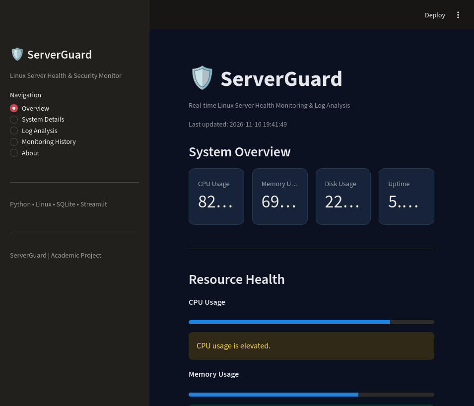
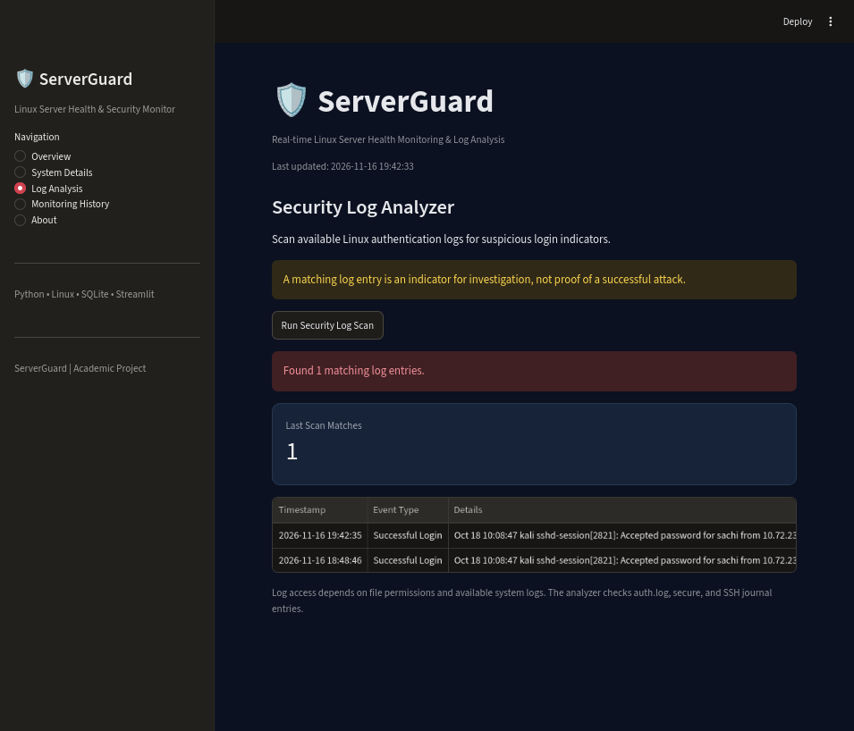
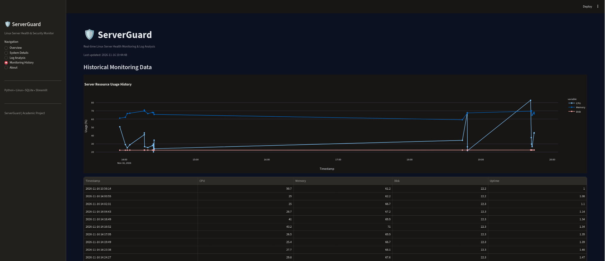

# ServerGuard
### Linux Server Health Monitoring and Log Analysis System

ServerGuard is a Python-based monitoring and security log analysis
application designed to monitor Linux system resources and identify
authentication-related events.

## Features

- CPU utilization monitoring
- RAM utilization monitoring
- Disk usage monitoring
- System uptime tracking
- Linux authentication log analysis
- Successful SSH login detection
- Failed login indicator detection
- SQLite monitoring history
- Interactive charts and visual dashboard
- CSV export of monitoring history

## Technology Stack

| Technology | Purpose |
|---|---|
| Python | Application development |
| Linux | Operating environment |
| Streamlit | Web dashboard |
| SQLite | Data storage |
| Psutil | System monitoring |
| Pandas | Data processing |
| Plotly | Interactive charts |
| Git | Version control |

## Project Structure

    linux-server-health-monitor/
    |
    |-- app.py
    |-- monitor.py
    |-- database.py
    |-- log_analyzer.py
    |-- requirements.txt
    |-- README.md
    |-- .gitignore
    |-- data/

## Installation

Clone the repository:

    git clone https://github.com/YOUR-USERNAME/linux-server-health-monitor.git

Navigate into the project:

    cd linux-server-health-monitor

Create a virtual environment:

    python3 -m venv .venv

Activate the environment:

    source .venv/bin/activate

Install dependencies:

    pip install -r requirements.txt

Run the application:

    streamlit run app.py

Open the local dashboard:

    http://localhost:8501

## Security Log Analysis

The application analyzes available Linux authentication logs
and SSH journal entries for indicators such as:

- Successful SSH logins
- Failed password attempts
- Authentication failures
- Invalid usernames

A matching log entry is an indicator for investigation,
not proof of a successful attack.

Log availability depends on system configuration and permissions.

## Future Enhancements

- Docker containerization
- GitHub Actions CI/CD pipeline
- Prometheus and Grafana integration
- AWS cloud deployment
- Automated security notifications
- Advanced authentication analytics

## Project Purpose

Developed as an academic and portfolio project to demonstrate
Python programming, Linux administration, system monitoring,
database integration and security log analysis.

## License

This project is licensed under the MIT License.
## Dashboard Screenshots

### System Overview

### Security Log Analysis

### Monitoring History

## Project Author
Developed as a hands-on DevOps and Linux monitoring project.
